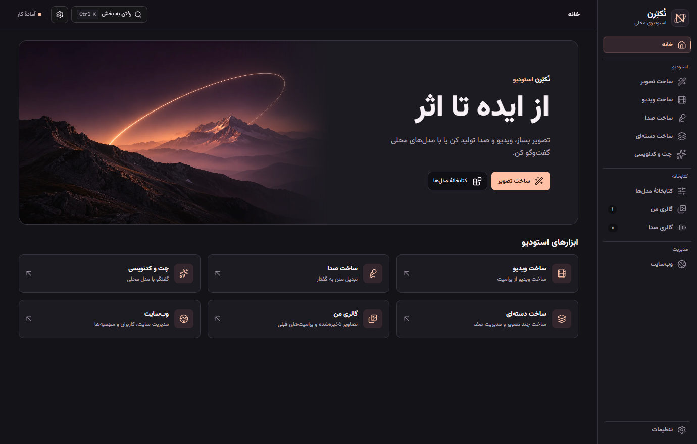
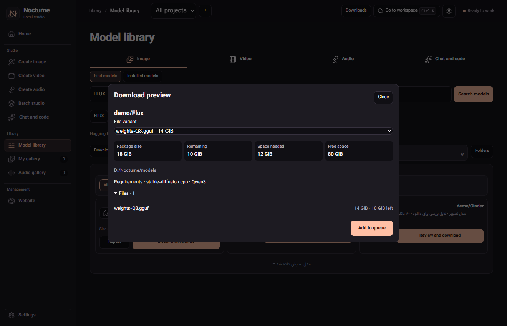

# ناکترن استودیو

Nocturne Studio برنامهٔ ویندوزی برای ساخت تصویر، ویدیو و گفتار و گفتگو با مدل‌های هوش مصنوعی محلی است. برنامه کتابخانهٔ مدل‌ها، گالری، صف ساخت تصویر و رابط فارسی و انگلیسی دارد.

[دریافت نسخهٔ ویندوز یا Debian](https://github.com/Manixpcshot/nocturne-studio/releases/latest) · [English](README.md)

نسخهٔ اندروید تصویر و متن را روی خود گوشی می‌سازد و مدل‌های متناسب با سخت‌افزار را پیشنهاد می‌دهد. [دانلود نسخهٔ اندروید](https://github.com/Manixpcshot/nocturne-studio/releases/latest) · [راهنمای اندروید](mobile/android/README.md)

نسخهٔ ۲ آیکون تازه، تم گرافیتی و هلویی و صفحهٔ خانه با میان‌بر استودیوها، کتابخانهٔ مدل‌ها و گالری دارد. حالت‌های ساخت، ویرایش و مقایسه در نوار استودیوی تصویر قرار دارند. تم و صفحهٔ شروع را می‌توانی در تنظیمات انتخاب کنی.

## امکانات

- ساخت تصویر از پرامپت، ویرایش با مدل سازگار و مقایسهٔ دو مدل.
- صف ساخت تصویر با پرامپت، مدل، تعداد و نسبت تصویر جدا برای هر کار. می‌توانی کارها را تکثیر و جابه‌جا کنی و پیش‌نویس را نگه داری.
- جست‌وجو و نصب مدل‌های سازگار Hugging Face، از جمله مدل‌های کامل Diffusers و بعضی بسته‌های GGUF مانند FLUX.1 Schnell و Dev.
- ساخت ویدیو و گفتار با مدل سازگار و نگهداری خروجی‌ها در گالری محلی.
- گفتگو با مدل‌های محلی از طریق Ollama یا llama.cpp و بررسی فایل‌های متنی انتخاب‌شده در حالت ایجنت.
- انتخاب تم، زبان، اعلان‌ها و مسیر پوشه‌های مدل و خروجی در تنظیمات.

## پروژه‌ها و ادامهٔ صف

- پروژه را از نوار بالا بساز یا انتخاب کن. هر پروژه پیش‌نویس، پرامپت‌های ذخیره‌شده، عکس‌های مرجع، صف و نمای گالری خودش را دارد. عکس مرجع را از **استودیوی تصویر ← ویرایش** بارگذاری کن و بعداً از فهرست عکس‌های مرجع پروژه بازش کن.
- در **ساخت دسته‌ای ← صف کارها**، گزینهٔ **ترکیب پرامپت و مدل** همهٔ ترکیب‌های پرامپت، مدل و نسبت تصویر را پیش‌نمایش می‌دهد. تیک ترکیب‌های اضافی را بردار و بقیه را به صف اضافه کن.
- پس از توقف یا بستن برنامه، پروژه را باز کن و **ادامهٔ صف** را بزن. با همان پوشهٔ خروجی، عکس‌هایی که از این صف ذخیره شده‌اند دوباره ساخته نمی‌شوند.
- از نمایشگر گالری، **ساخت نسخهٔ تازه** پرامپت و تنظیمات موجود عکس را برمی‌گرداند. **نسخه‌های مرتبط** عکس اصلی و نسخه‌های حاصل از آن را نشان می‌دهد.
- در کتابخانهٔ مدل‌ها، **بررسی** حجم دانلود و بخش باقی‌مانده، پیش‌نیاز موتور و قابلیت دریافت عکس را نشان می‌دهد. مقدار حافظه تخمینی است و به دستگاه و تنظیمات ساخت بستگی دارد.

## مرکز دانلود و FLUX

از دکمهٔ **دانلودها** در نوار بالا، صف مدل‌های تصویر، ویدیو، صدا و چت را مدیریت کن. قبل از افزودن به صف، فایل‌های انتخاب‌شده و فضای دیسک را ببین. مکث فایل نیمه‌کاره را نگه می‌دارد. برنامه صف را بعد از اجرا بازیابی می‌کند و پس از قطع اتصال دوباره تلاش می‌کند. مدل زمانی آماده نشان داده می‌شود که موتور نصب آن را تشخیص بدهد. مدل‌های تصویر و ویدیوی سازگار را می‌توان بررسی و تعمیر کرد. حذف فایل نیمه‌کاره تأیید جداگانه دارد.

می‌توانی یک یا دو دریافت هم‌زمان انتخاب کنی. بسته‌های با موتور مشترک به‌ترتیب دریافت می‌شوند. سقف سرعت برای دریافت مستقیم فایل اعمال می‌شود. دانلودهای Ollama و بعضی فایل‌های چت از سازوکار خود موتور استفاده می‌کنند.

موتور stable-diffusion.cpp برای GGUF از FLUX.1 Schnell، Dev و Kontext و از FLUX.2 Dev، Klein و Klein Base در نسخه‌های ۴ و ۹ میلیاردی پشتیبانی می‌کند. برنامه رمزگذار و VAE متناسب را انتخاب می‌کند. مدل‌های کامل سازگار با Diffusers هم قابل نصب‌اند. برای FLUX Fill ماسک سیاه‌وسفید هم‌اندازهٔ تصویر و برای Canny/Depth تصویر کنترل آماده را در **ویرایش** بده. میان‌برهای FLUX، FLUX.2، Uncensored و FLUX Uncensored در کتابخانه جست‌وجو می‌کنند. سازگاری به قالب مخزن و دسترسی مدل بستگی دارد.

## Debian 13

بستهٔ amd64 را از Releases بگیر و با `sudo apt install ./Nocturne-Studio_*_amd64.deb` نصب کن. برنامه را از منوی برنامه‌ها باز کن. وابستگی‌های Python در محیط خصوصی برنامه نصب می‌شوند.

موتور تصویر GGUF روی CPU یا Vulkan اجرا می‌شود. موتورهای چت در ویندوز و Debian شامل Ollama و نسخه‌های CPU، Vulkan، CUDA، ROCm و OpenVINO از llama.cpp هستند. موتورهای GPU به کارت و درایور سازگار نیاز دارند و هنگام انتخاب دانلود می‌شوند.

## به‌روزرسانی برنامه

برای فعال‌شدن به‌روزرسانی، یک‌بار نسخهٔ تازه را دستی نصب کن. نسخهٔ نصبی ویندوز هنگام باز شدن، ریلیز تازه را بررسی و امضای نصب‌کننده را تأیید می‌کند. Debian پیش از نصب بستهٔ امضاشده اجازهٔ مدیر سیستم می‌خواهد. نسخهٔ قابل‌حمل با ZIP تازه به‌روز می‌شود. اندروید فایل نسخهٔ تازه را خودکار دانلود می‌کند و برای نصب تأیید می‌خواهد.

## نصب

۱. از بخش انتشار، نصب‌کنندهٔ ویندوز ۶۴ بیتی را بگیر. برای نسخهٔ قابل‌حمل، کل ZIP را استخراج کن و `nocturne-studio.exe` را باز کن.

۲. برنامه در اجرای اول Python 3.13 و وابستگی‌های آن را بررسی می‌کند. نصب‌کنندهٔ ویندوز می‌تواند WebView2 را نصب کند.

۳. به **کتابخانهٔ مدل‌ها** برو، سازگاری و حجم مدل را بررسی کن، سپس آن را دانلود و از **مدل‌های نصب‌شده** انتخاب کن.

۴. برای ساخت دسته‌ای، در **ساخت دسته‌ای ← صف کارها** برای هر کار پرامپت و مدل را انتخاب کن و صف را اجرا کن. برای تغییر زبان، وارد **تنظیمات ← ظاهر ← زبان برنامه** شو.

وزن مدل‌ها جداگانه دانلود می‌شوند و حافظه و فضای لازم به مدل و موتور اجرا بستگی دارد. دانلود مدل، ترجمهٔ خودکار و دسترسی عمومی اختیاری وب ممکن است از اینترنت استفاده کنند.

برای اجرای سورس روی ویندوز، Node.js، Rust، Python 3.13، WebView2 و ابزارهای MSVC C++ را نصب کن و در پوشهٔ پروژه `npm ci` و سپس `npm run tauri dev` را اجرا کن. برای ساخت نصب‌کننده، کلید امضای Tauri را در `TAURI_SIGNING_PRIVATE_KEY` تنظیم کن و `npm run tauri build` را اجرا کن. تصاویر و نام مدل‌های داخل اسکرین‌شات‌ها دادهٔ نمونه‌اند.
