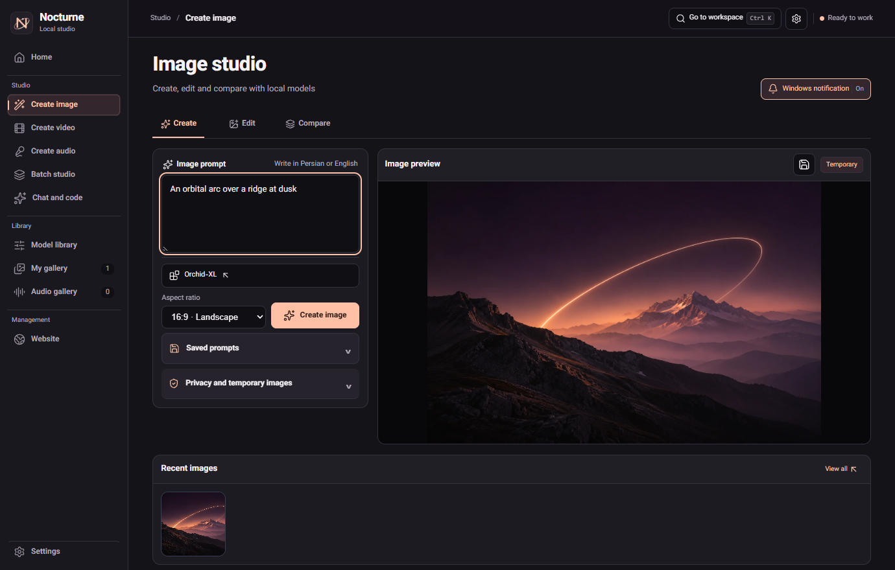
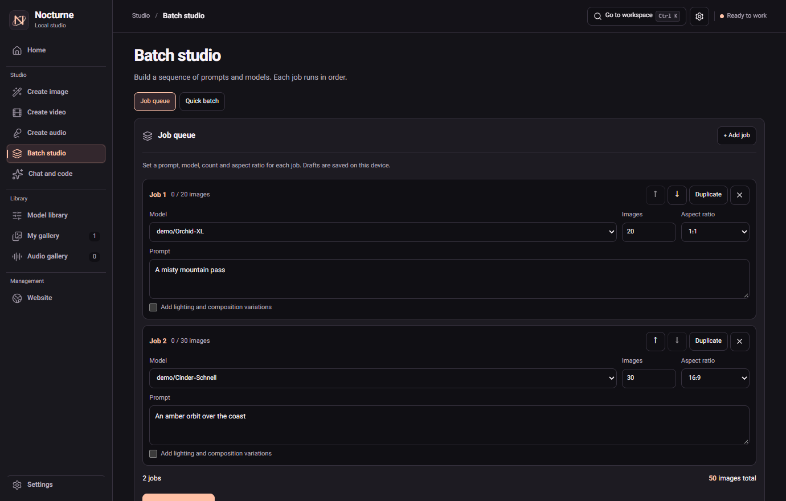
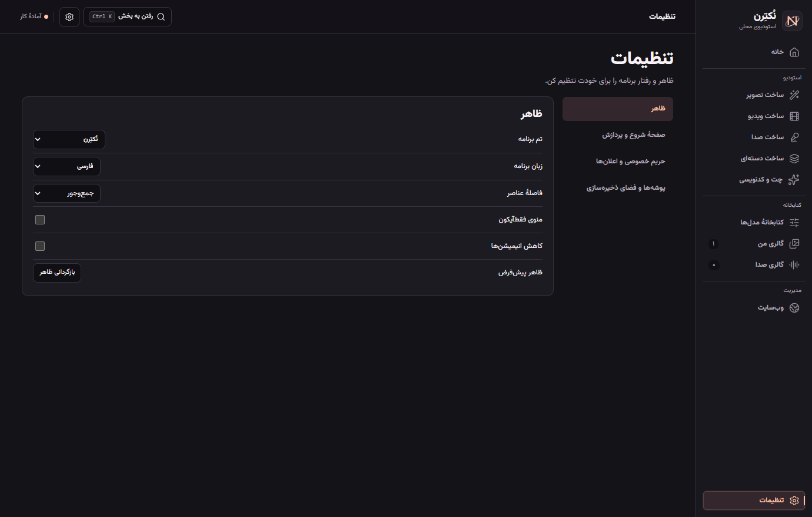

# ناکترن استودیو

Nocturne Studio برنامهٔ ویندوزی برای ساخت تصویر، ویدیو و گفتار و گفتگو با مدل‌های هوش مصنوعی محلی است. برنامه کتابخانهٔ مدل‌ها، گالری، صف ساخت تصویر و رابط فارسی و انگلیسی دارد.

[دریافت نسخهٔ ویندوز](https://github.com/Manixpcshot/nocturne-studio/releases/latest) · [English](README.md)

نسخهٔ ۲ آیکون تازه، تم گرافیتی و هلویی و صفحهٔ خانه با میان‌بر استودیوها، کتابخانهٔ مدل‌ها و گالری دارد. حالت‌های ساخت، ویرایش و مقایسه در نوار استودیوی تصویر قرار دارند. تم و صفحهٔ شروع را می‌توانی در تنظیمات انتخاب کنی.

## امکانات

- ساخت تصویر از پرامپت، ویرایش با مدل سازگار و مقایسهٔ دو مدل.
- صف ساخت تصویر با پرامپت، مدل، تعداد و نسبت تصویر جدا برای هر کار. می‌توانی کارها را تکثیر و جابه‌جا کنی و پیش‌نویس را نگه داری.
- جست‌وجو و نصب مدل‌های سازگار Hugging Face، از جمله مدل‌های کامل Diffusers و بعضی بسته‌های GGUF مانند FLUX.1 Schnell و Dev.
- ساخت ویدیو و گفتار با مدل سازگار و نگهداری خروجی‌ها در گالری محلی.
- گفتگو با مدل‌های محلی از طریق Ollama یا llama.cpp و بررسی فایل‌های متنی انتخاب‌شده در حالت ایجنت.
- انتخاب تم، زبان، اعلان‌ها و مسیر پوشه‌های مدل و خروجی در تنظیمات.

## نصب

۱. از بخش انتشار، نصب‌کنندهٔ ویندوز ۶۴ بیتی را بگیر. برای نسخهٔ قابل‌حمل، کل ZIP را استخراج کن و `nocturne-studio.exe` را باز کن.

۲. برنامه در اجرای اول Python 3.13 و وابستگی‌های آن را بررسی می‌کند. نصب‌کنندهٔ ویندوز می‌تواند WebView2 را نصب کند.

۳. به **کتابخانهٔ مدل‌ها** برو، سازگاری و حجم مدل را بررسی کن، سپس آن را دانلود و از **مدل‌های نصب‌شده** انتخاب کن.

۴. برای ساخت دسته‌ای، در **ساخت دسته‌ای ← صف کارها** برای هر کار پرامپت و مدل را انتخاب کن و صف را اجرا کن. برای تغییر زبان، وارد **تنظیمات ← ظاهر ← زبان برنامه** شو.

وزن مدل‌ها جداگانه دانلود می‌شوند و حافظه و فضای لازم به مدل و موتور اجرا بستگی دارد. دانلود مدل، ترجمهٔ خودکار و دسترسی عمومی اختیاری وب ممکن است از اینترنت استفاده کنند.

برای اجرای سورس روی ویندوز، Node.js، Rust، Python 3.13، WebView2 و ابزارهای MSVC C++ را نصب کن و در پوشهٔ پروژه `npm ci` و سپس `npm run tauri dev` را اجرا کن. برای ساخت نصب‌کننده از `npm run tauri build` استفاده کن. تصاویر و نام مدل‌های داخل اسکرین‌شات‌ها دادهٔ نمونه‌اند.
