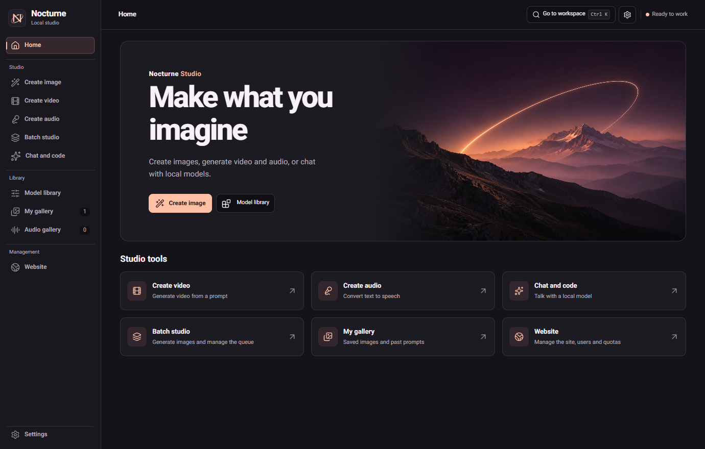
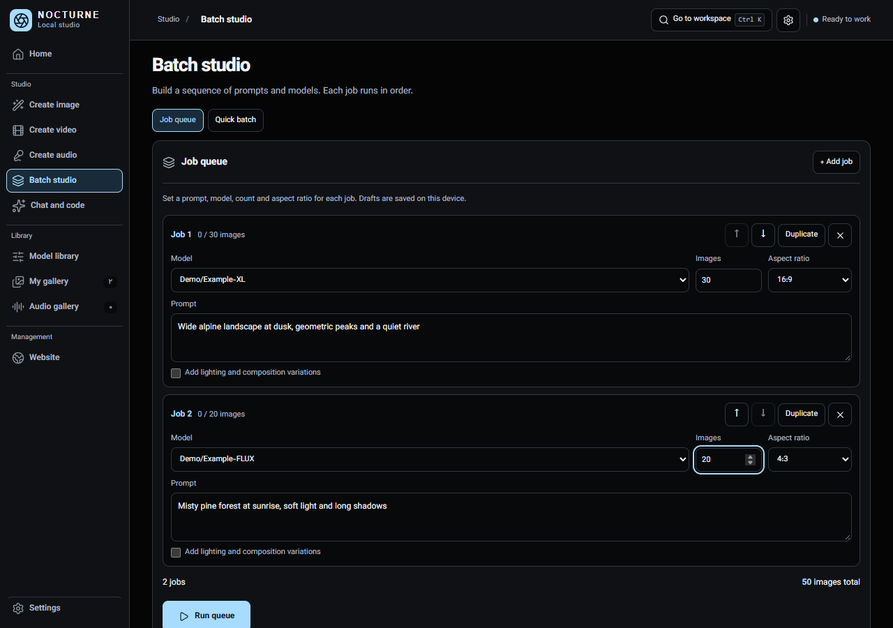
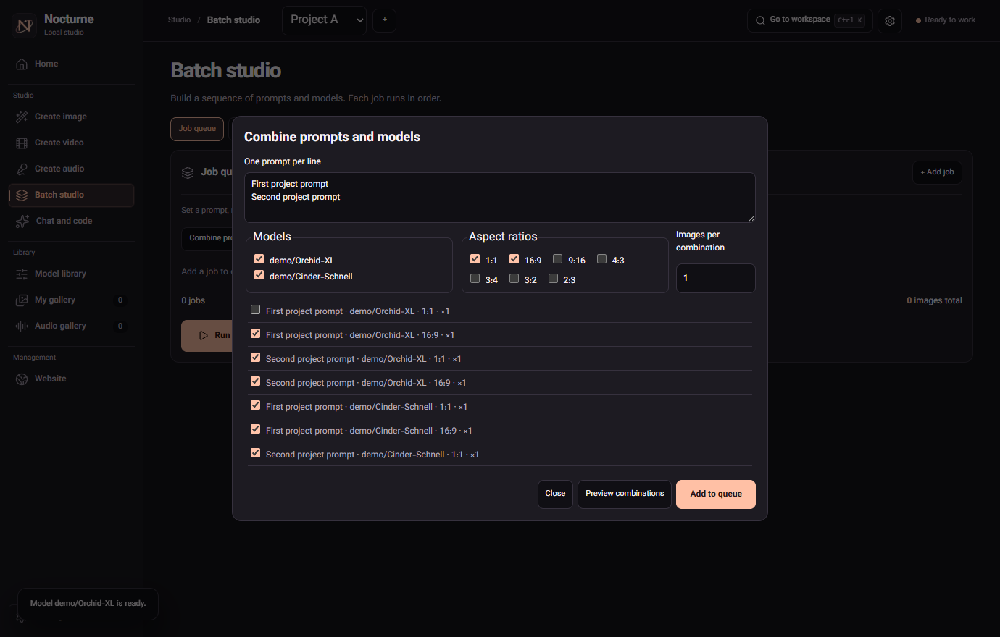
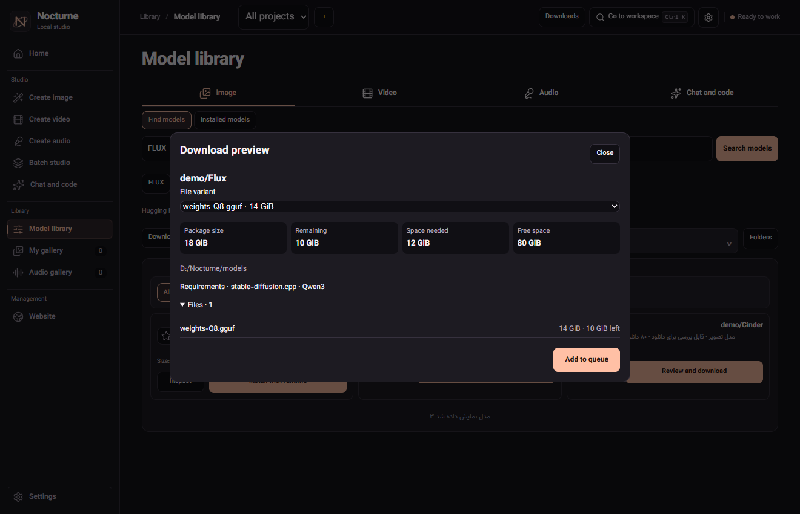

# Nocturne Studio

Nocturne Studio is a Windows desktop app for generating images, video and speech, and chatting with local AI models. The app includes a model library, a gallery, a queue for image batches and Persian and English interface options.

[Download the Windows release](https://github.com/Manixpcshot/nocturne-studio/releases/latest) · [راهنمای فارسی](README.fa.md)

The Android edition generates images on the phone and recommends models based on available hardware. [Download for Android](https://github.com/Manixpcshot/nocturne-studio/releases/tag/mobile-v0.2.1) · [Android guide](mobile/android/README.md)



Version 2.0 introduces a new app icon, a graphite-and-peach theme and a home screen with shortcuts to the studios, model library and gallery. The image studio keeps its Create, Edit and Compare modes in a dedicated toolbar. Choose your theme and startup page in Settings.

## What you can do

- Generate images from prompts, edit images with compatible models and compare two models side by side.
- Set a prompt, model, image count and aspect ratio for each job in the batch queue. Save drafts, duplicate jobs and change their order.
- Find and install supported Hugging Face models. The app can run full Diffusers pipelines and selected GGUF image packages, including FLUX.1 Schnell and Dev.
- Generate video or speech with supported models and organize outputs in local galleries.
- Chat with local models using Ollama or compatible llama.cpp runtimes. The agent mode can inspect selected text attachments, and code blocks can be opened and saved.
- Set model and output folders, change themes, configure notifications and choose Persian or English under **Settings → Appearance**.




## Projects and resumable queues

- Use the project selector in the top bar to start or switch projects. Each project has its own prompt drafts, presets, saved reference images, batch queue and gallery view. Upload reference images in **Image studio → Edit** and reuse them from **Project references**.
- In **Batch studio → Job queue**, use **Combine prompts and models** to preview all chosen prompt, model and aspect-ratio combinations. Uncheck any jobs you want to omit before adding them.
- If a job stops or the app closes, reopen the project and select **Resume queue**. Use the same output folder. The queue skips images already saved by that run.
- Open a photo in the gallery and select **Create a new version** to reuse its saved prompt and available settings. **Related versions** groups the original and its descendants.
- In **Model library**, select **Inspect** to see the download plan, remaining known bytes, engine requirements and image-input support. Working memory is an estimate and varies by device and generation settings.



## Downloads and FLUX

Open **Downloads** in the top bar for the shared image, video, speech and chat queue. Review a package from its library card to see the selected files and known disk usage. Pause keeps partial files. The app restores queued downloads after a restart, and retries connection failures with a countdown. A finished transfer becomes ready after the runtime recognizes the installation. Use **Verify and repair** to check supported image and video packages, or explicitly clear an incomplete transfer's private partial files.

Set one or two simultaneous transfers. Downloads with a shared engine are queued in order, and the optional speed limit applies to direct file transfers. Ollama and Hub-managed chat files follow their own engine and cache behavior.

The Windows stable-diffusion.cpp route supports GGUF packages for FLUX.1 Schnell, Dev and Kontext, and FLUX.2 Dev, Klein and Klein Base (4B and 9B). It selects the corresponding VAE and text encoder, and offers the available GGUF variants. Diffusers handles compatible full repositories. In **Edit**, provide a matching black-and-white mask for FLUX Fill or a prepared control image for FLUX Canny/Depth. The **FLUX**, **FLUX.2**, **Uncensored**, and **FLUX Uncensored** shortcuts search Hugging Face. Community uploads still need an identifiable compatible format and any required repository access.



## Install and run

1. Open the latest release and download the Windows x64 installer. For a portable copy, download the ZIP, extract the whole archive and run `nocturne-studio.exe`.
2. On first launch, the app checks Python 3.13 and its dependencies and offers setup where needed. The Windows installer can install WebView2.
3. Open **Model library**, inspect a model to check its compatibility and size, then download it. Go to **Installed models** to select it.
4. Open the studio you want to use. For image batches, open **Batch studio → Job queue** and add each job before clicking **Run queue**.

Model files are downloaded separately. The memory and disk space required depend on the model, runtime and settings. Check access terms for gated repositories. Inference runs locally for installed models. Model downloads, automatic translation and optional public web access can use an internet connection.


## Build from source

Use a Windows x64 development environment with Node.js, Rust, Python 3.13, WebView2 and the MSVC C++ build tools. In the project root, run:

```powershell
npm ci
npm run tauri dev
```

Run `npm run tauri build` for a release installer. The NSIS installer is generated in `src-tauri/target/release/bundle/nsis`.

The desktop UI uses TypeScript and Vite. Tauri runs the desktop shell and communicates with the Python engine under `src-tauri/resources`. Sample images and model names in the screenshots are demonstration data.
