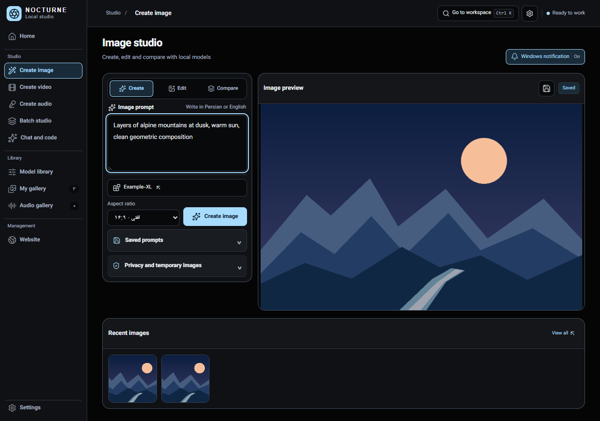
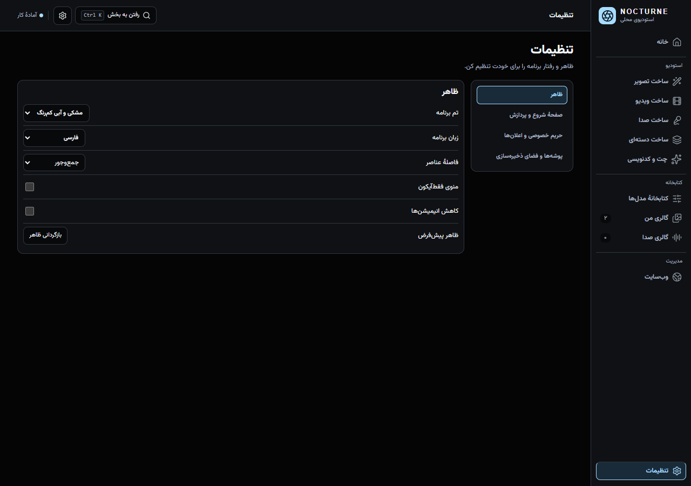

# Nocturne Studio

Nocturne Studio is a Windows desktop app for generating images, video and speech, and chatting with local AI models. The app includes a model library, a gallery, a queue for image batches and Persian and English interface options.

[Download the Windows release](https://github.com/Manixpcshot/nocturne-studio/releases/latest) · [راهنمای فارسی](README.fa.md)



## What you can do

- Generate images from prompts, edit images with compatible models and compare two models side by side.
- Set a prompt, model, image count and aspect ratio for each job in the batch queue. Save drafts, duplicate jobs and change their order.
- Find and install supported Hugging Face models. The app can run full Diffusers pipelines and selected GGUF image packages, including FLUX.1 Schnell and Dev.
- Generate video or speech with supported models and organize outputs in local galleries.
- Chat with local models using Ollama or compatible llama.cpp runtimes. The agent mode can inspect selected text attachments, and code blocks can be opened and saved.
- Set model and output folders, change themes, configure notifications and choose Persian or English under **Settings → Appearance**.


## Install and run

1. Open the latest release and download the Windows x64 installer. For a portable copy, download the ZIP, extract the whole archive and run `nocturne-studio.exe`.
2. On first launch, the app checks Python 3.13 and its dependencies and offers setup where needed. The Windows installer can install WebView2.
3. Open **Model library**, inspect a model to check its compatibility and size, then download it. Go to **Installed models** to select it.
4. Open the studio you want to use. For image batches, open **Batch studio → Job queue** and add each job before clicking **Run queue**.

Model files are downloaded separately. The memory and disk space required depend on the model, runtime and settings. Check access terms for gated repositories. Inference runs locally for installed models. Model downloads, automatic translation and optional public web access can use an internet connection.



## Build from source

Use a Windows x64 development environment with Node.js, Rust, Python 3.13, WebView2 and the MSVC C++ build tools. In the project root, run:

```powershell
npm ci
npm run tauri dev
```

Run `npm run tauri build` for a release installer. The NSIS installer is generated in `src-tauri/target/release/bundle/nsis`.

The desktop UI uses TypeScript and Vite. Tauri runs the desktop shell and communicates with the Python engine under `src-tauri/resources`. Sample images and model names in the screenshots are demonstration data.
