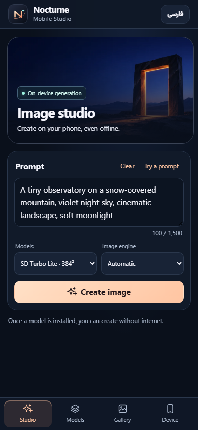
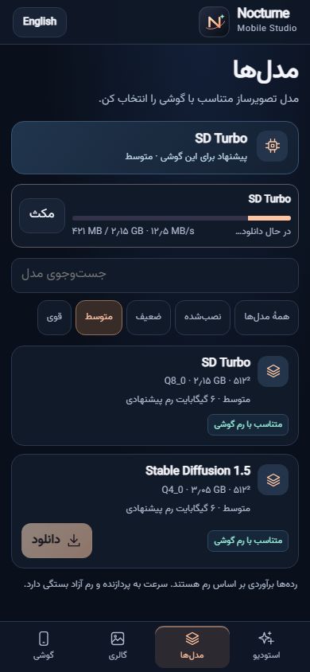

# Nocturne Studio Mobile

Android edition of Nocturne Studio for on-device images and text. Open Models to install a model, then open Studio for images or Chat for text. The app needs internet to download model weights. Image generation, prompts, and the gallery work locally after installation. Images can be exported as PNG through the system file picker.

[Download Nocturne Mobile](https://github.com/Manixpcshot/nocturne-studio/releases/latest)




## Device support

- Android 9 (API 28) or later with a 64-bit ARM processor and an up-to-date System WebView or Chrome.
- The Device screen reports the graphics renderer and available Vulkan version alongside the CPU, memory and internal storage. It also offers automatic, Vulkan GPU, hybrid, CPU and fast CPU processing.
- GPU and hybrid processing are available when Android reports a Vulkan 1.2+ driver and the APK contains the Vulkan library. Hybrid puts denoising on the GPU and text encoding and image decoding on the CPU. A failed Vulkan run is retried once on the CPU. The native GPU driver is loaded in a process separate from the CPU engine.
- Fast CPU mode uses [TAESD](https://huggingface.co/madebyollin/taesd) with SD 1.x and SD Turbo. It decodes images with less work and can lose fine detail.
- A separate app process runs inference so the interface can report an engine failure or a system memory kill.
- Model recommendations use Android's reported physical RAM. The phone can report less than its marketed capacity because firmware reserves part of it. Generation also checks available memory and storage.

| Tier | Packaged model choices | Approx. download | Output |
| --- | --- | --- | --- |
| Weak, 4 GB RAM | SD Turbo Lite Q4 | 1.85 GB | 384 × 384 |
| Medium, 6 GB RAM | DreamShaper 8 Q8, SD Turbo Q8, Stable Diffusion 1.5 Q4 | 1.80–3.05 GB | 512 × 512 |
| Strong, 8–12 GB RAM | SDXL Turbo Q4 and HQ Q8 | 3.94–5.04 GB | 512 × 512 |
| Strong, 12 GB RAM | FLUX.2 Klein 4B Q4, Z-Image Turbo Q3 | 5.29–5.98 GB | 512 × 512 |

Model checkpoints download separately. Downloads use pinned Hugging Face revisions, preserve partial files for resume and verify the size and SHA-256 of each part before making a model selectable. The two multipart models include their text encoder and autoencoder in the listed download size. The catalog lists source repositories in [models.json](app/src/main/assets/models.json). Each model is subject to the terms shown in its source repository.

## Text and app updates

Chat runs GGUF text models on the CPU through llama.cpp. SmolLM2 360M and Qwen2.5 0.5B are the smaller options. Qwen2.5 1.5B, Gemma 3 1B and Llama 3.2 1B need more memory. Image processing uses stable-diffusion.cpp with CPU and supported Vulkan modes.

Once this version is installed, the app checks GitHub while opening and downloads a newer APK with release metadata. Verify status or retry under **Device → App updates**. Android asks permission for installations from the app and asks you to confirm the APK installation.

## Build from source

SDK packages are Android SDK Platform 35, Build Tools 35.0.0, NDK 27.2.12479018 and CMake 3.31.6. Install JDK 17 or 21 and Git. On Windows, the script prepares pinned stable-diffusion.cpp and llama.cpp, builds both native libraries and signs a development APK.

```powershell
./build-apk.ps1 -Sdk 'C:/path/to/Android/Sdk'
```

The file lands in `build/Nocturne-Mobile.apk`. Keep the generated key in `build/nocturne-debug.jks` to sign update APKs for the same test installation. Use the PowerShell build for an APK that includes the chat engine.

For the Vulkan APK, put a Windows C/C++ toolchain such as w64devkit and the SDK CMake tools on PATH so ggml can build a host shader generator. Install [SPIRV-Headers](https://github.com/KhronosGroup/SPIRV-Headers) (tested with tag `vulkan-sdk-1.4.350.1`) and check out [Vulkan-Headers 1.4.350](https://github.com/KhronosGroup/Vulkan-Headers/tree/v1.4.350). Then point the build script to their header and CMake directories.

```powershell
./build-apk.ps1 -Sdk 'C:/path/to/Android/Sdk' -VulkanHeaders 'C:/path/to/Vulkan-Headers/include' -SpirvConfig 'C:/path/to/spirv/share/cmake/SPIRV-Headers'
```

## بررسی روی گوشی

۱. APK را روی گوشی اندرویدی باز کن و اجازهٔ نصب را برای همان برنامه‌ای که فایل را باز کرده بده.
۲. از پایین صفحه «گوشی» را باز کن تا ردهٔ پیشنهادی، پردازنده، گرافیک، رم و فضای داخلی را ببینی.
۳. در «مدل‌ها» یکی از مدل‌های متناسب را دانلود کن و صبر کن وضعیت «آمادهٔ استفاده» نمایش داده شود.
۴. در «استودیو» پرامپت بنویس یا پرامپت نمونه را بزن و «ساخت تصویر» را انتخاب کن. عکس در گالری داخلی ذخیره می‌شود.
